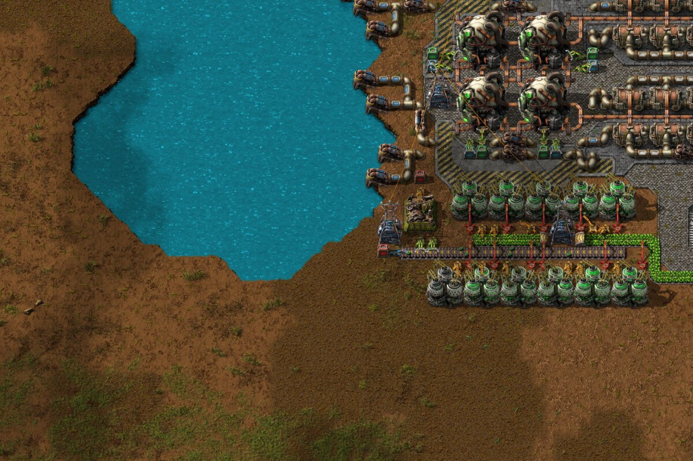
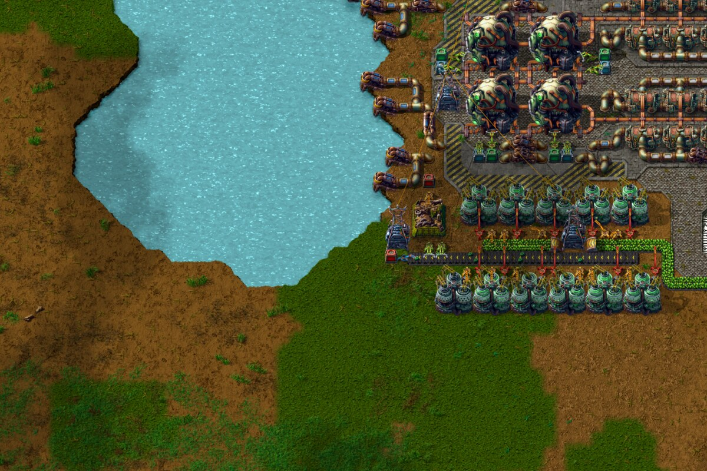
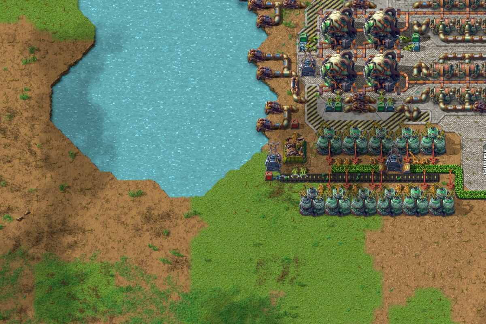
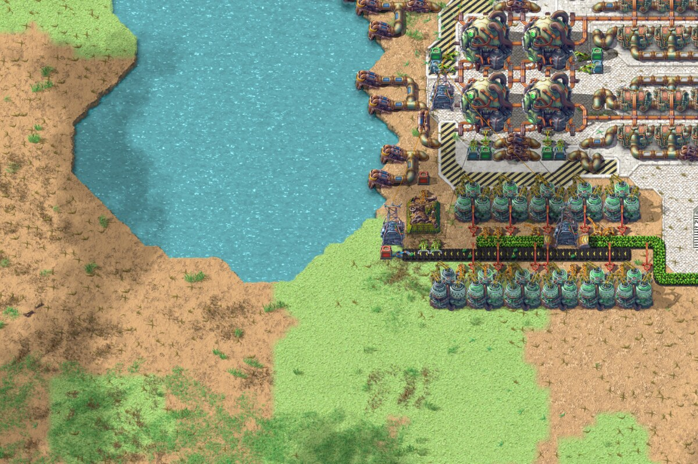
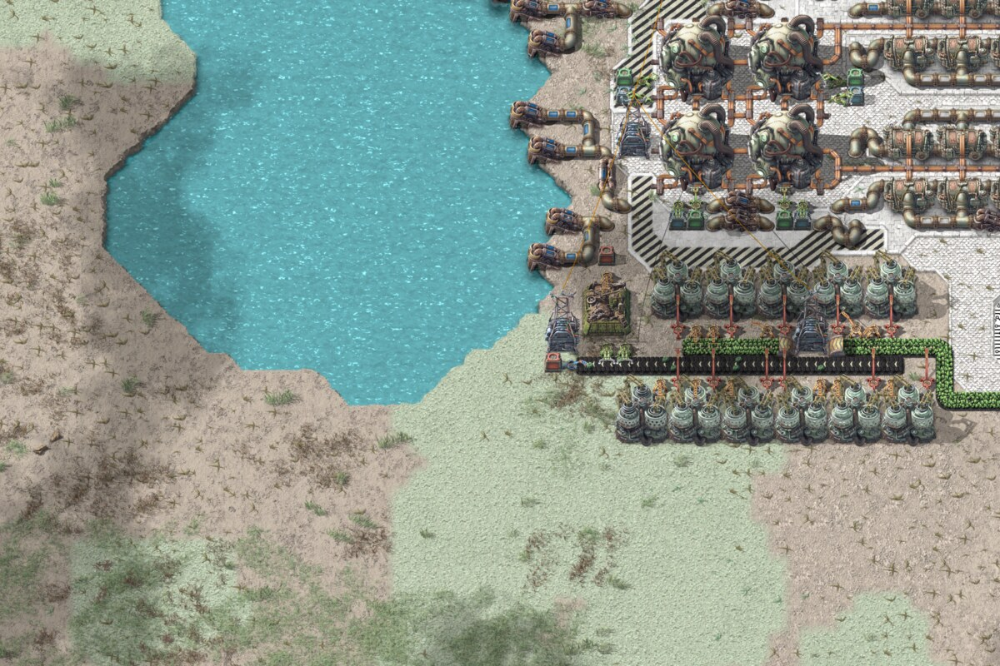
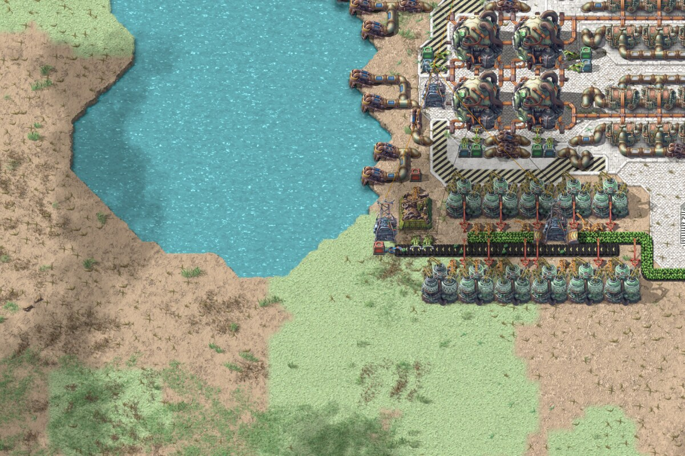

# Pastel Factorio

A Factorio 2.1 mod that repaints the world in bright, soft pastel colors.

A main menu scene from each planet, recorded with the mod:

**Nauvis**: Logistic Robots

[<!-- video: media/videos/nauvis-logistic-robots.mp4 -->](https://private-user-images.githubusercontent.com/33184886/687950642-f1551796-2b4a-4297-bb3d-78baa86afffe.mp4?jwt=eyJ0eXAiOiJKV1QiLCJhbGciOiJIUzI1NiJ9.eyJpc3MiOiJnaXRodWIuY29tIiwiYXVkIjoicmF3LmdpdGh1YnVzZXJjb250ZW50LmNvbSIsImtleSI6ImtleTUiLCJleHAiOjE3OTMyMTU0ODIsIm5iZiI6MTc5MzIxNTE4MiwicGF0aCI6Ii8zMzE4NDg4Ni82ODc5NTA2NDItZjE1NTE3OTYtMmI0YS00Mjk3LWJiM2QtNzhiYWE4NmFmZmZlLm1wND9YLUFtei1BbGdvcml0aG09QVdTNC1ITUFDLVNIQTI1NiZYLUFtei1DcmVkZW50aWFsPUFLSUFWQ09EWUxTQTUzUFFLNFpBJTJGMjAyNjEwMjglMkZ1cy1lYXN0LTElMkZzMyUyRmF3czRfcmVxdWVzdCZYLUFtei1EYXRlPTIwMjYxMDI4VDE5MTk0MlomWC1BbXotRXhwaXJlcz0zMDAmWC1BbXotU2lnbmF0dXJlPWM0Y2VhMjcwM2U4MjkxMzYwYTMyODBlMGQwNWMyMzNjYjMwOThkZjMzNDMyZTAxOThmZmZhYWVmYTAyNTE0MGUmWC1BbXotU2lnbmVkSGVhZGVycz1ob3N0JnJlc3BvbnNlLWNvbnRlbnQtdHlwZT12aWRlbyUyRm1wNCJ9.Bvzjkb0A3l6lC05RumPn-7YbhByG4bCtpWDr8N2c9as)

**Vulcanus**: Punishment

[<!-- video: media/videos/vulcanus-punishment.mp4 -->](https://private-user-images.githubusercontent.com/33184886/687961408-3e95cea5-49b4-4f7a-a4ae-e7a010e7eeb9.mp4?jwt=eyJ0eXAiOiJKV1QiLCJhbGciOiJIUzI1NiJ9.eyJpc3MiOiJnaXRodWIuY29tIiwiYXVkIjoicmF3LmdpdGh1YnVzZXJjb250ZW50LmNvbSIsImtleSI6ImtleTUiLCJleHAiOjE3OTMyMTU0ODIsIm5iZiI6MTc5MzIxNTE4MiwicGF0aCI6Ii8zMzE4NDg4Ni82ODc5NjE0MDgtM2U5NWNlYTUtNDliNC00ZjdhLWE0YWUtZTdhMDEwZTdlZWI5Lm1wND9YLUFtei1BbGdvcml0aG09QVdTNC1ITUFDLVNIQTI1NiZYLUFtei1DcmVkZW50aWFsPUFLSUFWQ09EWUxTQTUzUFFLNFpBJTJGMjAyNjEwMjglMkZ1cy1lYXN0LTElMkZzMyUyRmF3czRfcmVxdWVzdCZYLUFtei1EYXRlPTIwMjYxMDI4VDE5MTk0MlomWC1BbXotRXhwaXJlcz0zMDAmWC1BbXotU2lnbmF0dXJlPTdlMzVlZTA1NzdlNjM5NjdkOTJlMDk1ODM5ODM3MmE4YTNmZjMxZGJkZTNkNWE1MmY0OWZjZWRhYjRhOWM5YjEmWC1BbXotU2lnbmVkSGVhZGVycz1ob3N0JnJlc3BvbnNlLWNvbnRlbnQtdHlwZT12aWRlbyUyRm1wNCJ9.AyIpePkWPd75SUQ54LcIAr8CbpvYRpp74tJfjrNKr18)

**Gleba**: Egg escape

[<!-- video: media/videos/gleba-egg-escape.mp4 -->](https://private-user-images.githubusercontent.com/33184886/687945453-c267cdce-464a-4924-8d6f-39da7f34d874.mp4?jwt=eyJ0eXAiOiJKV1QiLCJhbGciOiJIUzI1NiJ9.eyJpc3MiOiJnaXRodWIuY29tIiwiYXVkIjoicmF3LmdpdGh1YnVzZXJjb250ZW50LmNvbSIsImtleSI6ImtleTUiLCJleHAiOjE3OTMyMTQ5MDAsIm5iZiI6MTc5MzIxNDYwMCwicGF0aCI6Ii8zMzE4NDg4Ni82ODc5NDU0NTMtYzI2N2NkY2UtNDY0YS00OTI0LThkNmYtMzlkYTdmMzRkODc0Lm1wND9YLUFtei1BbGdvcml0aG09QVdTNC1ITUFDLVNIQTI1NiZYLUFtei1DcmVkZW50aWFsPUFLSUFWQ09EWUxTQTUzUFFLNFpBJTJGMjAyNjEwMjglMkZ1cy1lYXN0LTElMkZzMyUyRmF3czRfcmVxdWVzdCZYLUFtei1EYXRlPTIwMjYxMDI4VDE5MTAwMFomWC1BbXotRXhwaXJlcz0zMDAmWC1BbXotU2lnbmF0dXJlPWY2ZjY4ZTZkZmZhNWM3M2RmNmMzOGIzYzMwNGZkZjA0YjQ0OGE5MTQ2ODU4MDljZDA0ODU0NjYxNGMxZDdhMWImWC1BbXotU2lnbmVkSGVhZGVycz1ob3N0JnJlc3BvbnNlLWNvbnRlbnQtdHlwZT12aWRlbyUyRm1wNCJ9.zIDrbOBrAmpr6X7upaW4ARCDU6V397x6kkuvdKDsiKE)

**Fulgora**: City crossing

[<!-- video: media/videos/fulgora-city-crossing.mp4 -->](https://private-user-images.githubusercontent.com/33184886/687946666-ecfe7e02-33fd-4158-9d8b-32ae46a14253.mp4?jwt=eyJ0eXAiOiJKV1QiLCJhbGciOiJIUzI1NiJ9.eyJpc3MiOiJnaXRodWIuY29tIiwiYXVkIjoicmF3LmdpdGh1YnVzZXJjb250ZW50LmNvbSIsImtleSI6ImtleTUiLCJleHAiOjE3OTMyMTQ5MDAsIm5iZiI6MTc5MzIxNDYwMCwicGF0aCI6Ii8zMzE4NDg4Ni82ODc5NDY2NjYtZWNmZTdlMDItMzNmZC00MTU4LTlkOGItMzJhZTQ2YTE0MjUzLm1wND9YLUFtei1BbGdvcml0aG09QVdTNC1ITUFDLVNIQTI1NiZYLUFtei1DcmVkZW50aWFsPUFLSUFWQ09EWUxTQTUzUFFLNFpBJTJGMjAyNjEwMjglMkZ1cy1lYXN0LTElMkZzMyUyRmF3czRfcmVxdWVzdCZYLUFtei1EYXRlPTIwMjYxMDI4VDE5MTAwMFomWC1BbXotRXhwaXJlcz0zMDAmWC1BbXotU2lnbmF0dXJlPThlZjM4MTA3NjM4ZWNkMDFjMGQyMmY0ZGQ5NWVjMjA4Zjc0NTY4MDg2MGRmMTUwZTQyYzU2YTVjNDY2ZjdhN2UmWC1BbXotU2lnbmVkSGVhZGVycz1ob3N0JnJlc3BvbnNlLWNvbnRlbnQtdHlwZT12aWRlbyUyRm1wNCJ9.Z0IhGWYQaMQoUx6MITNj6xSJIPpZe6cLFGbSGgsMJ3I)

**Aquilo**: Send help

[<!-- video: media/videos/aquilo-send-help.mp4 -->](https://private-user-images.githubusercontent.com/33184886/687947031-f039d10e-2147-41c3-bc2a-ef2ce017d296.mp4?jwt=eyJ0eXAiOiJKV1QiLCJhbGciOiJIUzI1NiJ9.eyJpc3MiOiJnaXRodWIuY29tIiwiYXVkIjoicmF3LmdpdGh1YnVzZXJjb250ZW50LmNvbSIsImtleSI6ImtleTUiLCJleHAiOjE3OTMyMTQ5MDAsIm5iZiI6MTc5MzIxNDYwMCwicGF0aCI6Ii8zMzE4NDg4Ni82ODc5NDcwMzEtZjAzOWQxMGUtMjE0Ny00MWMzLWJjMmEtZWYyY2UwMTdkMjk2Lm1wND9YLUFtei1BbGdvcml0aG09QVdTNC1ITUFDLVNIQTI1NiZYLUFtei1DcmVkZW50aWFsPUFLSUFWQ09EWUxTQTUzUFFLNFpBJTJGMjAyNjEwMjglMkZ1cy1lYXN0LTElMkZzMyUyRmF3czRfcmVxdWVzdCZYLUFtei1EYXRlPTIwMjYxMDI4VDE5MTAwMFomWC1BbXotRXhwaXJlcz0zMDAmWC1BbXotU2lnbmF0dXJlPTg2YTAxMDI1MzUxMDI1MWRhMzE2MWQ5YmRjZGNhODllZDdjZGFlY2Q4OWZiNjI3ZDhiYjdjNDBhMmMyMTdhYTcmWC1BbXotU2lnbmVkSGVhZGVycz1ob3N0JnJlc3BvbnNlLWNvbnRlbnQtdHlwZT12aWRlbyUyRm1wNCJ9.1Arxp74AX05WOtrP1-NPBUWny6kOzFkU9ckPT9YDTOQ)

## Features

- Recolored terrain, water, ores, trees and decoratives, enemies, icons and technologies.
- Vulcanus, Fulgora, Gleba, Aquilo and space platforms, each keeping its own character, liquids included.
- Every building, including those of Space Age, Quality, Recycler and Elevated Rails.
- Black rubber belts with pastel tier colors.
- Softer shadows and gentler night, dawn and sunset lighting.
- Purely visual. The game's own files are never modified, and disabling the mod restores the vanilla look.
- Works with other mods: any sprite that reuses a base game graphic is recolored too.

The recolored graphics are generated from your own copy of the game, so the mod is built locally
rather than downloaded.

## Quick start

You need Factorio 2.1, [Rust](https://rustup.rs/), [just](https://github.com/casey/just), `rsync`, `zip`
and about 6 GB of free disk space (more with Space Age).

1. In `pastel.toml`, under `[paths]`, set `factorio_dir` to the game's install folder and
   `factorio_user_dir` to its user data folder (`~/.factorio` on Linux).
2. Quit Factorio, then run:

   ```sh
   just setup             # build the recoloring tool
   just import-graphics   # copy the game's vanilla graphics into data/
   just install           # recolor the graphics, assemble the mod and install it
   ```

3. Start Factorio. **Pastel Factorio** is in the Mods menu, already enabled.

To change the look, edit `settings.toml` and run `just install` again, for example `brightness = 0.5`
for a gentler lift or `vulcanus = false` to leave Vulcanus as it is. To remove the mod, run
`just uninstall` or disable it in the Mods menu.

## Configuration

In game, under **Settings → Mod settings → Startup**:

| Setting | Effect |
|---|---|
| Pastel graphics | Use the recolored sprites and liquid colors. Turn off to keep only the Nauvis water colors. |
| Water color strength | 0 keeps the vanilla water, 1 applies the colors below in full. |
| Water color, Deep water color | Target colors as hex codes. |

Everything else is configured in two files. After editing either, run `just install` again; only
the files affected by the change are recolored again.

- **`settings.toml`**: your settings. Overall brightness and saturation, which **groups** are
  recolored (`vulcanus`, `fulgora`, `gleba`, `aquilo`, `space`, `nauvis`, `icons`, `buildings`;
  `false` leaves a group vanilla, its liquids included), the named colors, and the liquid colors.
- **`pastel.toml`**: how the recoloring works. Game paths, the files in each group, how each
  category of graphics is recolored, and which category every file belongs to.

### Brightness and saturation

The two overall settings in `settings.toml`, each from 0 to 1, shown on the same spot of a main menu scene.
1 is the pastel look as designed (the default); lower values blend back toward the game.

| Vanilla | Brightness 0 | Brightness 0.5 | Default (1) |
|---|---|---|---|
|  |  |  |  |

| Saturation 0.3 | Saturation 0.6 | Default (1) |
|---|---|---|
|  |  |  |

Brightness decides how far dark areas are lifted: 0 keeps the game's own lightness and changes only
the colors. Saturation scales how colorful everything is: 0 is gray, 1 is the colors as designed.

To tune a color, preview a single file while editing either file:

```sh
just preview grass-1.png --watch
```

## Commands

Run `just` for the full list. Commands that change the mods folder or the game's folders refuse to
run while Factorio is open.

### Recoloring

**`just build`** recolors the vanilla graphics in `data/` into `data/*/updated_graphics`. Only files
whose source or settings changed since the last build are recolored again, and every result is
checked against its original; problems are listed in `build/build_report.csv`.

```sh
just build                           # recolor what changed since the last build
just build --only 'terrain.*,ore.*'  # only these categories; everything else stays as it is
just build --clean                   # delete the output and recolor everything
just build --jobs 4                  # 4 worker threads (default: CPU count - 1)
```

The build stops if `data/` looks recolored already, for example after an older version of this
project replaced the game's graphics. Import fresh graphics, or add `--force` if they are vanilla.

**`just preview <file>`** recolors one file in memory and opens a before/after image, also saved in
`build/preview/`. `<file>` is a filename or any part of a path; when several files match, you pick
one from a list.

```sh
just preview grass-1.png                               # one terrain file
just preview entity/lab/lab.png                        # part of a path, when a filename is ambiguous
just preview iron-ore --pick 2                         # take the 2nd match without asking
just preview grass-1.png --crop 0,0,512,512 --tile 3   # a 512 px patch, repeated 3 x 3
just preview lab-light.png --bg dark                   # background: checker, grass, light or dark
just preview entity/lab/lab.png --zoom 0.5             # half size (default: about 1600 px wide)
just preview grass-1.png --watch                       # re-render on every save of either .toml file
just preview grass-1.png --no-open                     # only save the image
```

**`just sheets`** writes before/after contact sheets for each category to `build/sheets/`, after a
build.

```sh
just sheets                          # every category
just sheets --category 'terrain.*'   # only the terrain categories
just sheets --limit 24               # at most 24 files per sheet (default 48)
```

**`just validate`** checks every recolored file against its original again: same size, format and
transparency.

**`just scan`**, after a game update, reads the game's prototype data (Factorio runs once without a
window), finds the sprites it draws additively or as light, and updates their rules in
`pastel.toml` so their black stays black.

**`just pastel <command>`** runs any command of the `pastel` tool:

```sh
just pastel classify    # the category of every PNG, in build/classification_report.csv
just pastel inventory   # every source file, in build/inventory.csv
```

### Mod and game

| Command | What it does |
|---|---|
| `just install` | Build, assemble and install the mod into the mods folder, replacing other versions of it and the older Pastel Water mod. Files are hard-linked when both folders are on the same disk. |
| `just uninstall` | Remove the mod from the mods folder. |
| `just assemble` | Build, then put the mod together in `build/mod/pastel-factorio_<version>/` without installing it. |
| `just package` | Assemble the mod and zip it into `build/pastel-factorio_<version>.zip`, for sharing. |
| `just restore-graphics` | Put back the game's own graphics if an older version of this project replaced them. |

### Setup and housekeeping

| Command | What it does |
|---|---|
| `just setup` | Build the `pastel` tool. Other commands also build it on first use. |
| `just import-graphics` | Copy the game's vanilla graphics into `data/`. Run it again after a game update. |
| `just paths` | Show the game and mods folders the commands use, from `pastel.toml`. |
| `just clean` | Delete the build output. The imported vanilla graphics stay. |

## Credits

The initial version was created by cozyfire.
